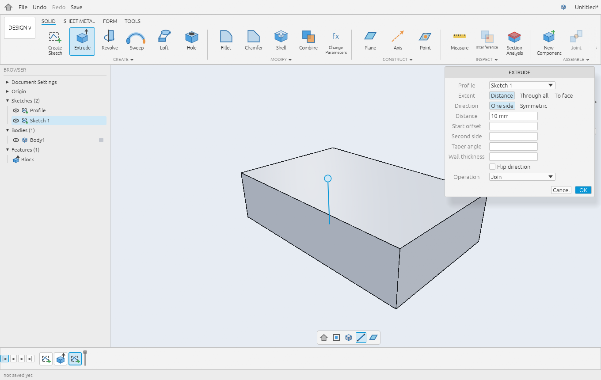
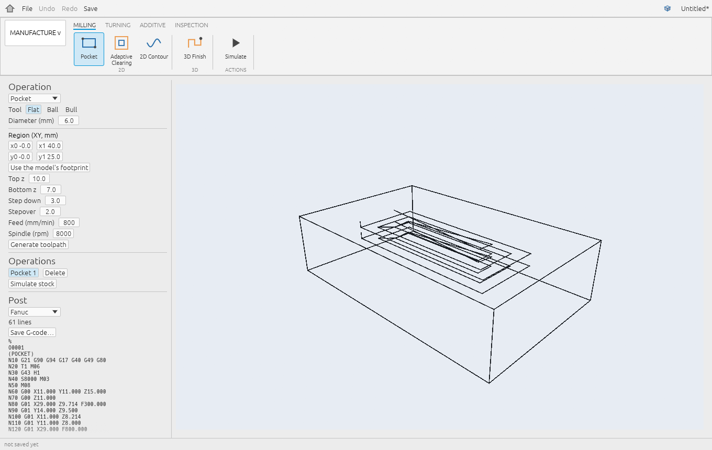
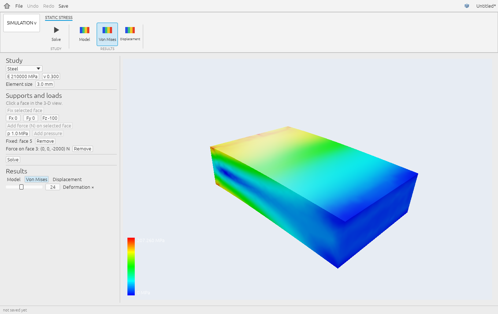
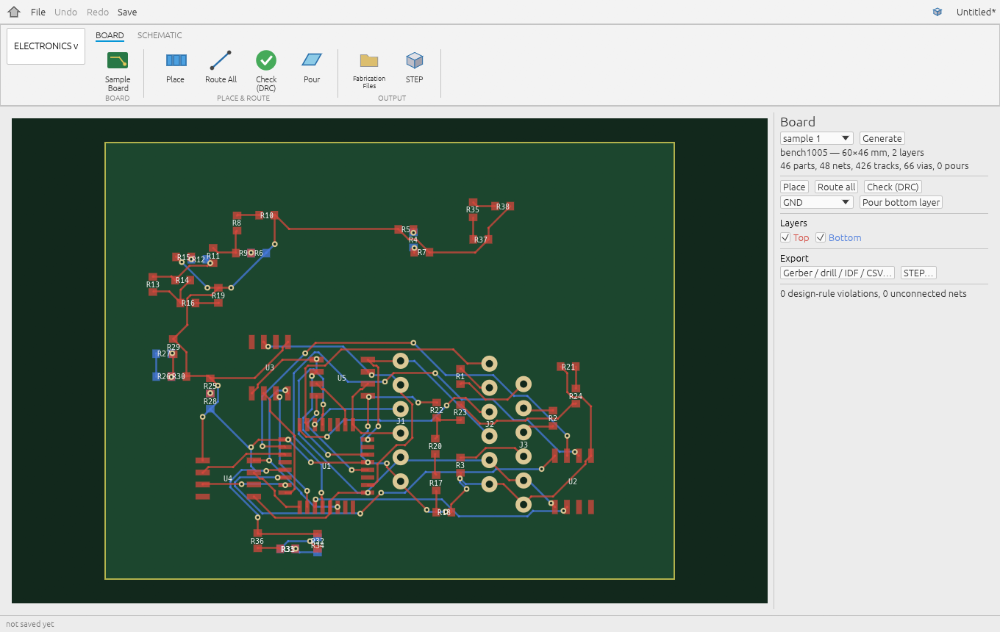
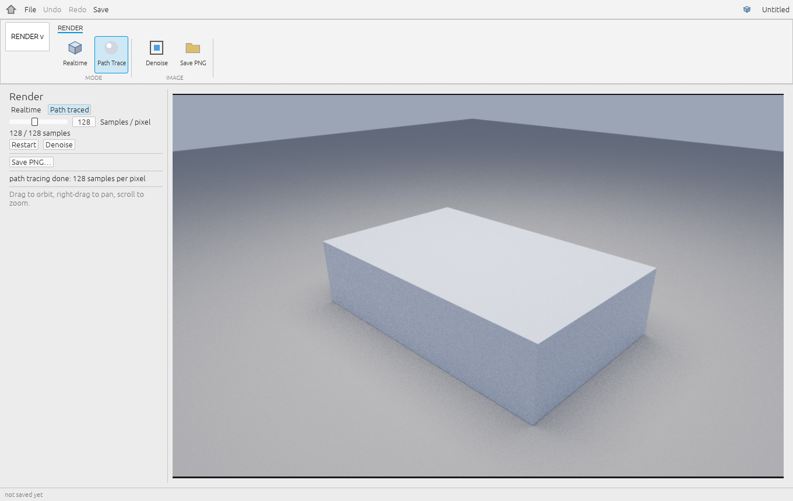
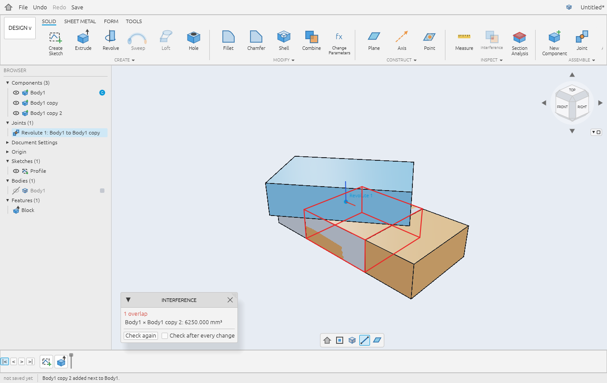
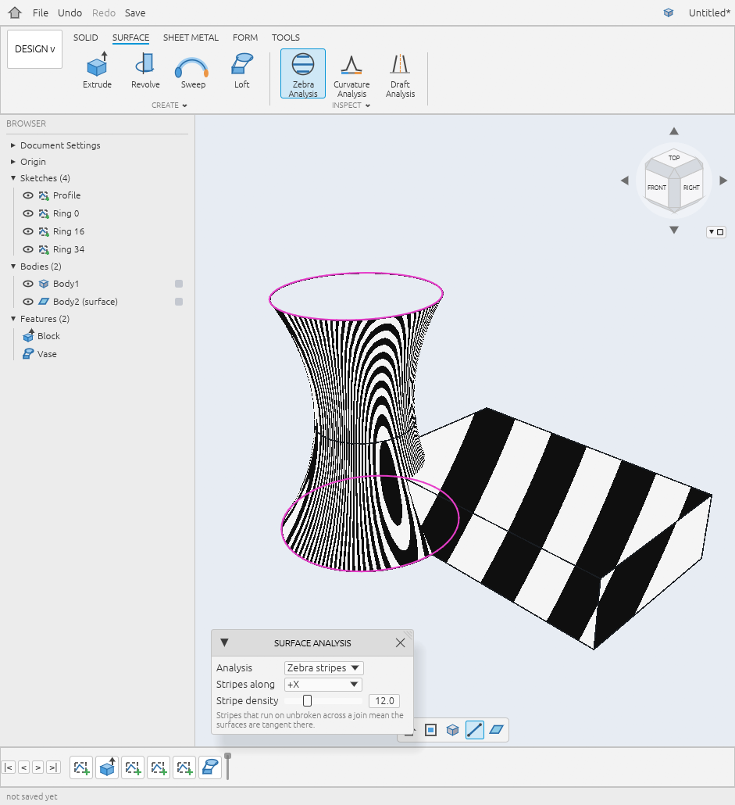
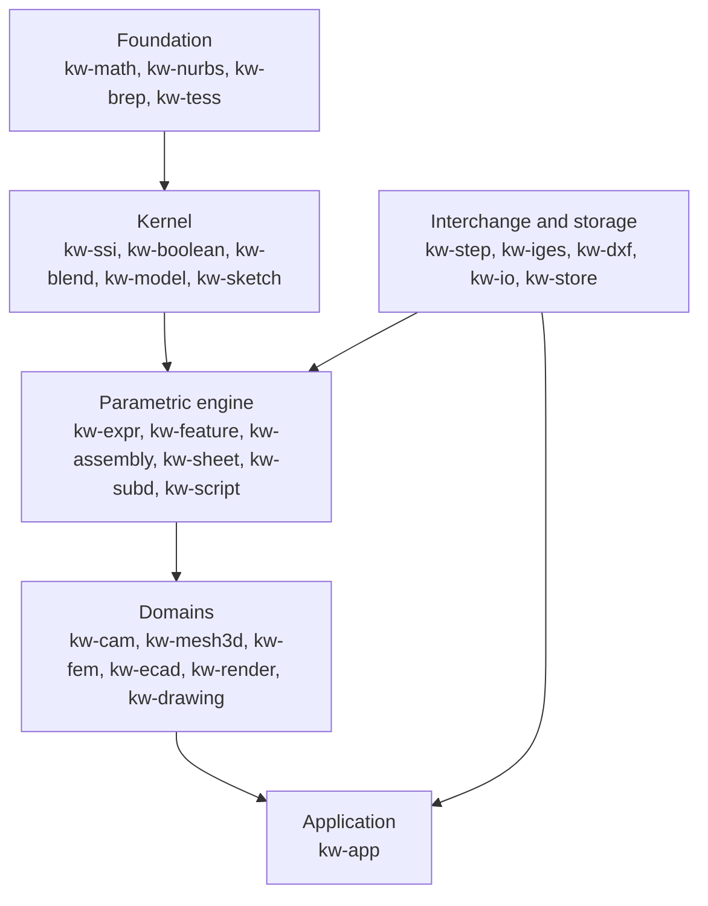

<div align="center">


# Kerfwright

**Sketch, machine, simulate and route in one program.**

A CAD, CAM, FEA and ECAD suite written in pure Rust, on its own B-rep kernel.

[](https://github.com/DwayneCrous/Kerfwright/actions/workflows/ci.yml)
[](LICENSE)
[](rust-toolchain.toml)
[](docs/STATUS.md)
[](#status)

[Features](#features) &nbsp;|&nbsp;
[Screenshots](#screenshots) &nbsp;|&nbsp;
[Quick start](#quick-start) &nbsp;|&nbsp;
[Architecture](#architecture) &nbsp;|&nbsp;
[Status](#status) &nbsp;|&nbsp;
[Documentation](#documentation)

<br>



</div>

<br>

## What it is

Kerfwright keeps the whole job in one project file. The sketches, the parametric history, the toolpaths, the
simulation studies and the circuit board all live in a single `.kwf` file, so changing a dimension in a sketch
reaches the G-code and the stress plot without an export step in between.

Everything is written in Rust, from the NURBS maths and the Boolean kernel up to the GPU renderer and the
egui application. It is **pre-release software**: the engines of phases 1 to 5 are built and measured, the
application is usable, and there are no installers yet.

## Features

<table>
<tr>
<td width="50%" valign="top">

### Design
* Constraint sketcher with a sparse solver, snapping and region picking
* Parametric timeline with rollback, reorder, suppress and named parameters
* Extrude, revolve, sweep, loft, hole, shell, draft, offset, patterns
* Fillets (constant and variable radius) and chamfers
* Booleans with a verified heal stage
* Sheet metal with flat patterns, SubD forms, surfaces with continuity analysis
* Assemblies with joints, mechanisms, interference and bill of materials

</td>
<td width="50%" valign="top">

### Manufacture
* 2.5-D pocket, contour, face, drill and bore operations
* Drop-cutter 3-D finishing, waterline, rest and swarf
* Tri-dexel stock simulation and holder collision checks
* Five-axis kinematics and 3+2 setups
* Five post-processors, each checked by an independent interpreter

</td>
</tr>
<tr>
<td width="50%" valign="top">

### Simulate
* Tetrahedral meshing with TET10 elements
* Static (direct and PCG) and modal studies
* Stress recovery and SIMP topology optimisation
* Supports and loads picked directly on faces

</td>
<td width="50%" valign="top">

### Electronics
* Placement, routing and design-rule checking
* Copper pour
* Gerber, Excellon, IDF, STEP and pick-and-place output
* Outputs cross-checked by two independent Gerber viewers

</td>
</tr>
<tr>
<td width="50%" valign="top">

### Render and draw
* Real-time frame with OIT, ambient occlusion and edges
* Path tracer on a BVH, with a denoiser
* Drawings with hidden-line views, sections, details, dimensions and a parts list, out to PDF and DXF

</td>
<td width="50%" valign="top">

### Exchange
* STEP (AP203, AP214, AP242) import and export
* IGES 5.3 import
* DXF, STL, OBJ with MTL, glTF and GLB
* Rhai scripting over the document builder

</td>
</tr>
</table>

## Screenshots

<table>
<tr>
<td width="50%"><br><sub><b>Manufacture.</b> A pocket toolpath with generated Fanuc G-code.</sub></td>
<td width="50%"><br><sub><b>Simulation.</b> Von Mises stress on a loaded, fixed block.</sub></td>
</tr>
<tr>
<td width="50%"><br><sub><b>Electronics.</b> A routed two-layer board with 0 rule violations.</sub></td>
<td width="50%"><br><sub><b>Render.</b> Path tracing at 128 samples per pixel.</sub></td>
</tr>
<tr>
<td width="50%"><br><sub><b>Assemblies.</b> A revolute joint with the interference volume outlined.</sub></td>
<td width="50%"><br><sub><b>Surfaces.</b> Zebra analysis on a lofted surface and a solid.</sub></td>
</tr>
</table>

<sub>Screenshots are taken from the real application by `scripts/app_acceptance.sh`.</sub>

## Quick start

You need Rust (the toolchain is pinned to stable by `rust-toolchain.toml`) and a GPU with a Vulkan, Metal or
DX12 driver.

```bash
git clone https://github.com/DwayneCrous/Kerfwright.git
cd Kerfwright
cargo run --release -p kw-app
```

That opens the welcome page: create a project, open a `.kwf` file, or open the demo part. Command-line
options:

| Option | Effect |
|---|---|
| `FILE.kwf` | Open a project directly |
| `--demo` | Open the demo part |
| `--workspace NAME` | Start in a given workspace |

<details>
<summary><b>More programs and acceptance scripts</b></summary>

<br>

```bash
cargo run --release -p kw-viewer                        # standalone viewer: drag = orbit, right-drag = pan, wheel = zoom
cargo run --release -p kw-viewer -- --scene million     # 1M-triangle scene
cargo run --release -p kw-sketcher -- --demo            # 2D sketcher (L line, R rectangle, C circle, D dimension)
cargo run -p kw-io --example export_primitives -- out/  # STL / OBJ / glTF / GLB of every primitive
```

Each phase has an acceptance script that runs every automated check for it:

| Script | Covers | Rough time |
|---|---|---|
| `scripts/app_acceptance.sh` | Application tests and a screenshot of every screen | needs a display |
| `scripts/phase1_acceptance.sh` | Maths, kernel skeleton, tessellator, exporters, viewer | |
| `scripts/phase2_acceptance.sh` | Sketcher and constraint solver, DXF | |
| `scripts/phase3_acceptance.sh` | B-rep kernel, including both 100,000-pair Boolean fuzzes | about 2.5 h |
| `scripts/phase4_acceptance.sh` | Parametric engine, file format, assemblies, sheet metal, SubD | about 10 min |
| `scripts/phase5_acceptance.sh` | CAM, FEA, ECAD, rendering (GPU needed for the rendering steps) | about 25 min |
| `scripts/surface_acceptance.sh` | Surface tools and their screenshots | |

</details>

## By the numbers

Measured by the acceptance scripts. Each figure has caveats; they are written down next to it in the linked
report and collected in [`docs/STATUS.md`](docs/STATUS.md).

| Area | Result | Report |
|---|---|---|
| Boolean kernel | 100,000 fuzzed pairs: 99.90 % on valid-expected cases, 0 invalid outputs | [Phase 3](docs/phase3-report.md) |
| Fillets and chamfers | 500 of 500 benchmark cases, including tangent chains and variable radius | [Phase 3](docs/phase3-report.md) |
| STEP | 259 of 259 public-corpus files; round trip with OpenCASCADE, truck and Gmsh | [Phase 3](docs/phase3-report.md) |
| Persistent naming | 1,716 scenarios, 0 silent wrong resolutions | [Phase 4](docs/phase4-report.md) |
| Sheet metal | Flat lengths exact to 1e-14 mm | [Phase 4](docs/phase4-report.md) |
| FEA | TET10 benchmarks within 0.1 to 1.8 %; 1 M DOF PCG in 81 s | [Phase 5](docs/phase5-report.md) |
| Routing | 1,023 of 1,023 nets routed with 0 DRC violations on 20 boards | [Phase 5](docs/phase5-report.md) |
| Rendering | 1 M triangles at 2.6 ms p95 (1080p) | [Phase 5](docs/phase5-report.md) |

## Architecture

The workspace is 34 crates. This is the rough layering, from the foundation up to the application; see the table below for every crate.



<details>
<summary><b>All 34 crates</b></summary>

<br>

**Foundation**

| Crate | Purpose |
|---|---|
| `kw-math` | Tolerance, frames, transforms, bounding boxes, robust predicates |
| `kw-nurbs` | Knot vectors, NURBS curves and surfaces (derivatives, insertion and removal, elevation, Bezier extraction, fitting, closest point), analytic geometry |
| `kw-brep` | Slotmap B-rep (coedge and radial ring), validation, primitive builders, shape history |
| `kw-tess` | Crack-free, edge-first tessellator |
| `kw-analysis` | Surface diagnostics: curvature, draft angle, zebra stripes, edge continuity (G0, G1, G2) |
| `kw-job` | Cancel flag, progress, capped thread pool |
| `kw-materials` | Material library shared by mass properties, FEA and CAM |

**Kernel**

| Crate | Purpose |
|---|---|
| `kw-ssi` | Surface-surface intersection: exact quadric cases, certified level-set tracing, signed-distance field for free-form surfaces |
| `kw-boolean` | Union, intersect, subtract: imprint, arrangement, classification, stitching, shape history |
| `kw-model` | Profiles to extrude, revolve, sweep and loft; shell, offset, draft; surface builders (Coons, ruled, stitch, offset, thicken, trim, extend, match) |
| `kw-blend` | Constant and variable radius fillets, tangent chains, chamfers |
| `kw-sketch` | Sketch entities, residual library with analytic Jacobians, decomposition, sparse LM solver, DOF and conflict analysis, drag solver |

**Parametric engine**

| Crate | Purpose |
|---|---|
| `kw-expr` | Dimension-checked expressions with units |
| `kw-feature` | Feature document and timeline, incremental engine with early cutoff, persistent topological names, the `.kwf` format |
| `kw-assembly` | Parts, instances, joints, kinematic loops, interference, mass |
| `kw-sheet` | Sheet metal: exact B-rep strips, bend allowance, flat pattern, refold |
| `kw-subd` | Catmull-Clark with creases, finished to a B-rep of bicubic patches |
| `kw-script` | Rhai scripting over the document builder API |

**Domains**

| Crate | Purpose |
|---|---|
| `kw-cam` | 2.5-D operations, drop-cutter, tri-dexel stock, five-axis kinematics, post DSL |
| `kw-gsim` | Independent interpreters for the five G-code and Klartext dialects |
| `kw-mesh3d` | Constrained Delaunay and refinement tetrahedral mesher, TET10, quality metrics |
| `kw-fem` | TET10 static (direct and PCG) and modal solvers, stress recovery, SIMP, closed-form references |
| `kw-ecad` | Board model, placement, router, DRC, pour, Gerber, Excellon, IDF, STEP, pick-and-place |
| `kw-fabcheck` | Two Gerber viewers and an Excellon parser used to check the outputs |
| `kw-render` | WBOIT, GTAO and edges frame, LBVH path tracer in WGSL, denoiser, f64 reference |
| `kw-drawing` | Sheets, hidden-line views, sections, details, dimensions, annotation, parts list, PDF and DXF |

**Interchange and storage**

| Crate | Purpose |
|---|---|
| `kw-step` | ISO 10303-21 parser, AP203, AP214 and AP242 B-rep import and export |
| `kw-iges` | IGES 5.3 import, trimmed surfaces sewn into solids |
| `kw-dxf` | ASCII DXF (R2000) reader and writer with sketch adapters |
| `kw-io` | STL, OBJ with MTL, glTF and GLB writers |
| `kw-store` | CAM, FEA, board and drawing entries inside the `.kwf` container |

**Applications**

| Crate | Purpose |
|---|---|
| `kw-app` | The application (egui): welcome page, projects, the workspaces, a Rayon and Tokio bridge |
| `kw-viewer` | Standalone wgpu viewer with PBR, edges and ID-buffer picking, windowed and headless |
| `kw-sketcher` | Standalone egui sketcher |

</details>

## Status

Kerfwright is built in six phases. Each phase has acceptance criteria and a report that says what was measured
and what fell short.

| Phase | Scope | State | Report |
|---|---|---|---|
| 1 | Maths foundation, kernel skeleton, tessellator, exporters, wgpu viewer | Implemented | [report](docs/phase1-report.md) |
| 2 | Sketcher and constraint solver, DXF, egui sketcher | Implemented | [report](docs/phase2-report.md) |
| 3 | B-rep kernel: SSI, Booleans, extrude, revolve, sweep, loft, fillet, shell, STEP, IGES | Implemented | [report](docs/phase3-report.md) |
| 4 | Parametric engine: expressions, incremental evaluation, persistent names, `.kwf`, assemblies, sheet metal, SubD, scripting | Implemented, two criteria partly met | [report](docs/phase4-report.md) |
| 5 | CAM, FEA, ECAD, advanced rendering | Implemented | [report](docs/phase5-report.md) |
| 6 | Not started | Planned | [roadmap](docs/04-roadmap.md) |

Some things you should know before relying on it:

* The Model workspace exposes only part of the engine's features so far.
* Sketching happens on a flat 2-D canvas, and the model is evaluated on the UI thread, so a very heavy model
  pauses the window.
* The Phase 5 suites, simulators and viewers are written in this repository, adaptive clearing is withheld
  from the default build (the `adaptive-clearing` cargo feature) until its freedom-to-operate review is recorded, and the IDF bottom-side convention is unverified.
* ECAD offers generated sample boards only.

The full list of caveats, with numbers, is in [`docs/STATUS.md`](docs/STATUS.md). The application is described in
[`docs/app-shell.md`](docs/app-shell.md) and its distance from a conventional parametric CAD workflow in
[`docs/reference-workflow-comparison.md`](docs/reference-workflow-comparison.md).

## Documentation

Read in this order if you are new to the codebase.

| | File | What it is |
|---|---|---|
| 0 | [`CLEAN_ROOM.md`](CLEAN_ROOM.md) | Provenance and IP policy: rules on sources, licensing and naming; epistemic labels used in the docs |
| 1 | [`docs/01-research/01-brep-kernel.md`](docs/01-research/01-brep-kernel.md) | B-rep topology, NURBS, SSI, Booleans, fillets, T-splines versus SubD |
| 1 | [`docs/01-research/02-constraint-solver.md`](docs/01-research/02-constraint-solver.md) | 2-D constraints, G0 to G3, LM, Newton and BFGS, decomposition, DOF analysis |
| 1 | [`docs/01-research/03-parametric-dag.md`](docs/01-research/03-parametric-dag.md) | Topological naming, feature DAG, incremental evaluation |
| 1 | [`docs/01-research/04-multidomain.md`](docs/01-research/04-multidomain.md) | CAM, FEA, ECAD, wgpu rendering |
| 1 | [`docs/01-research/05-rust-ecosystem.md`](docs/01-research/05-rust-ecosystem.md) | Crate evaluation and gap analysis |
| 2 | [`docs/02-PRD.md`](docs/02-PRD.md) | Product requirements, workspaces, SLAs, file formats |
| 3 | [`docs/03-architecture.md`](docs/03-architecture.md) | Rust domain models, memory, state and thread diagrams |
| 3 | [`docs/04-roadmap.md`](docs/04-roadmap.md) | Six-phase plan with acceptance criteria |
| | [`docs/app-shell.md`](docs/app-shell.md) | The application, screen by screen |
| | [`docs/STATUS.md`](docs/STATUS.md) | Measured results and caveats for every phase |

The `website/` directory holds the project site (Astro and Starlight), built from the same documents.

## Contributing

Issues and pull requests are welcome. Before opening one:

```bash
cargo fmt --all -- --check
cargo clippy --workspace --all-targets -- -D warnings
cargo test -p <crate>          # prefer per-crate runs; see below
```

* `cargo test --workspace` is what CI runs, but locally it is slow: the FEA and feature performance tests run
  for minutes, and the CAM, kernel and SubD suites want `--release`. Run the crate you changed.
* Eight pointer-driven tests in `crates/kw-app/tests/shell.rs` fail with an egui `TexturesDelta` panic on a
  clean checkout in at least one environment. Treat any other failure as new.
* Every algorithm needs a source. [`CLEAN_ROOM.md`](CLEAN_ROOM.md) lists what you may read and what you may not;
  read it before sending code that touches a solver, kernel or CAM routine.

## Provenance and patents

Kerfwright is an independent implementation of well-known CAD, CAM and CAE techniques. It is not affiliated with,
derived from or endorsed by Autodesk, Siemens, Spatial or any other CAD vendor. Its rules forbid proprietary code,
binaries and leaked source as inputs, and every non-trivial algorithm cites its source. Kerfwright does not claim
to be a "clean room" implementation in the legal sense, because no one can audit what an AI model used in drafting
code has seen. Statements about proprietary kernels in the research documents are labelled
**[Public]** or **[Inferred]**. Items that need legal review before shipping are tracked in
[`LICENSES/patent-watch.md`](LICENSES/patent-watch.md).

## Trademarks

See [`TRADEMARKS.md`](TRADEMARKS.md): vendor names are used only descriptively, and the Kerfwright name has no
trademark search recorded yet.

## License

Released under the [MIT License](LICENSE).
